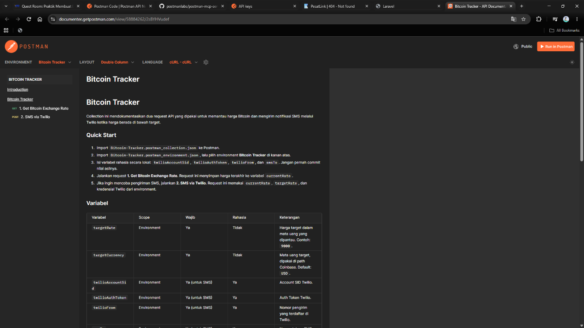
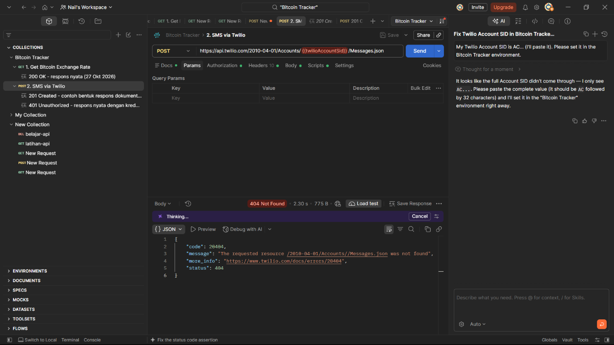

# Bitcoin Tracker - Postman API Documentation

Praktik dokumentasi API menggunakan Postman untuk Quest Room SMK Pesat, Pertemuan 20.

Collection ini memantau harga Bitcoin dari Coinbase dan mengirim notifikasi SMS melalui Twilio ketika harga Bitcoin berada di bawah target yang ditentukan.

> Baru pertama kali? Ikuti panduan langkah demi langkah dari nol sampai hasil akhir di **[TUTORIAL.md](TUTORIAL.md)**.

## Tujuan Praktik

- Mempraktikkan pembuatan dokumentasi API di Postman.
- Menyusun collection, environment, deskripsi request, contoh respons, dan test script.
- Menerbitkan dokumentasi collection agar mudah dibaca orang lain.
- Menyimpan artefak praktik di repository GitHub sebagai bukti pengumpulan.

## Daftar Request

| No | Nama Request | Method | Endpoint | Auth |
| --- | --- | --- | --- | --- |
| 1 | Get Bitcoin Exchange Rate | `GET` | `https://api.coinbase.com/v2/prices/BTC-{{targetCurrency}}/spot` | Tidak perlu |
| 2 | SMS via Twilio | `POST` | `https://api.twilio.com/2010-04-01/Accounts/{{twilioAccountSid}}/Messages.json` | Basic Auth |

### Alur kerja

1. Request pertama mengambil harga spot BTC dan menyimpannya ke variabel collection `currentRate`.
2. Request pertama juga menghitung `alertTriggered` (`true` jika harga < `targetRate`).
3. Request kedua menyusun body SMS dari `currentRate` dan `targetRate`, lalu mengirimnya lewat Twilio.

> Endpoint harga memakai Coinbase karena endpoint lama CoinDesk (`api.coindesk.com`) sudah tidak dipakai.

## Struktur Repository

```text
postman-api-documentation/
├── README.md
├── TUTORIAL.md
├── postman/
│   ├── Bitcoin-Tracker.postman_collection.json
│   ├── Bitcoin-Tracker.postman_environment.json
│   └── openapi.yaml
├── docs/
│   └── rangkuman-openapi.md
└── screenshots/
    └── README.md
```

## Environment dan Variabel

Import `postman/Bitcoin-Tracker.postman_environment.json`, lalu pilih environment **Bitcoin Tracker**.

| Variabel | Wajib | Rahasia | Contoh | Keterangan |
| --- | --- | --- | --- | --- |
| `targetRate` | Ya | Tidak | `9000` | Harga target. Notifikasi dianggap perlu jika harga < nilai ini. |
| `targetCurrency` | Ya | Tidak | `USD` | Mata uang target pada endpoint Coinbase. |
| `twilioAccountSid` | Ya (untuk SMS) | Ya | `ACxxxxxxxx...` | Account SID Twilio. |
| `twilioAuthToken` | Ya (untuk SMS) | Ya | kosong | Auth Token Twilio. |
| `twilioFrom` | Ya (untuk SMS) | Ya | `+62...` | Nomor pengirim Twilio. |
| `smsTo` | Ya (untuk SMS) | Ya | `+62...` | Nomor tujuan SMS. |

Variabel `currentRate`, `alertTriggered`, dan `smsBody` diisi otomatis oleh script, jadi tidak perlu diisi manual.

## Cara Import dan Menjalankan

1. Buka Postman, klik **Import**.
2. Import file `postman/Bitcoin-Tracker.postman_collection.json`.
3. Import file `postman/Bitcoin-Tracker.postman_environment.json`.
4. Pilih environment **Bitcoin Tracker** di kanan atas.
5. Buka **Environments > Bitcoin Tracker**, lalu isi variabel Twilio secara lokal.
6. Jalankan **1. Get Bitcoin Exchange Rate**. Pastikan semua test berstatus PASS.
7. Jalankan **2. SMS via Twilio** jika kredensial sudah lengkap.

### Menguji logika alert

Harga BTC pada saat praktik berada di sekitar **USD 79.000**, sedangkan `targetRate` bawaan adalah `9000` (mengikuti contoh video). Artinya `alertTriggered` akan bernilai `false`.

Untuk menguji kondisi alert, ubah `targetRate` menjadi angka di atas harga saat ini, misalnya `100000`, lalu jalankan ulang request pertama dan lihat nilai `alertTriggered` menjadi `true`.

## Contoh Respons

### 200 OK - Get Bitcoin Exchange Rate

Contoh nyata saat pengujian pada 27 Oktober 2026:

```json
{
  "data": {
    "amount": "79690.805",
    "base": "BTC",
    "currency": "USD"
  }
}
```

Harga selalu berubah, jadi nilai `amount` akan berbeda saat kamu menjalankan ulang.

### 401 Unauthorized - SMS via Twilio

Contoh nyata ketika diuji memakai kredensial dummy:

```json
{
  "code": 20003,
  "message": "auth account AC00000000000000000000000000000000 does not exist",
  "more_info": "https://www.twilio.com/docs/errors/20003",
  "status": 401
}
```

Contoh respons `201 Created` ada di collection. Bentuknya mengikuti dokumentasi Twilio dan **belum** dieksekusi dengan kredensial asli.

## Status Pengujian

Diuji pada 27 Oktober 2026 menggunakan Postman CLI `1.73.0`.

| Request | Status | Bukti |
| --- | --- | --- |
| Get Bitcoin Exchange Rate | Lulus | `200 OK`, 6 assertion PASS, harga terbaca `79690.805 USD`. |
| SMS via Twilio (end-to-end dengan kredensial dummy) | 401 sesuai harapan | `currentRate` berhasil diteruskan ke body SMS; Twilio menolak autentikasi dummy. |
| SMS via Twilio (pengiriman nyata) | Belum diuji | Butuh Account SID, Auth Token, nomor pengirim, dan nomor tujuan asli. |

Catatan: kegagalan assertion `Status 201 Created` pada uji dummy adalah hasil yang wajar karena tidak ada kredensial asli. Pengujian ini hanya memverifikasi wiring request dan penanganan error 401.

Perintah yang dipakai untuk menguji request harga:

```powershell
postman collection run "postman\Bitcoin-Tracker.postman_collection.json" -e "postman\Bitcoin-Tracker.postman_environment.json" -i "1. Get Bitcoin Exchange Rate" --report-events off
```

Untuk mencoba SMS tanpa kredensial asli:

```powershell
postman collection run "postman\Bitcoin-Tracker.postman_collection.json" -e "postman\Bitcoin-Tracker.postman_environment.json" --env-var "twilioAccountSid=AC00000000000000000000000000000000" --env-var "twilioAuthToken=dummy_token" --env-var "twilioFrom=+620000000000" --env-var "smsTo=+620000000000" --report-events off
```

## Dokumentasi Postman

**URL dokumentasi publik: https://documenter.getpostman.com/view/58884262/2sBYHVudef**

Dokumentasi sudah dipublikasikan ke Postman Cloud dengan environment **Bitcoin Tracker** (nilai rahasia dikosongkan). Dokumentasi akan otomatis ikut ter-update setiap kali collection di cloud diperbarui.

Dokumentasi yang sama juga bisa dibuka dari dalam Postman:

1. Buka workspace **Nail's Workspace** > collection **Bitcoin Tracker**.
2. Klik **...** di samping nama collection, lalu pilih **View complete documentation**.
3. Untuk publikasi ulang, gunakan `postman collection publish <collection-id> --environment <environment-id> --api-key <api-key>`.

## OpenAPI

File `postman/openapi.yaml` berisi spesifikasi OpenAPI 3.0.3 untuk dua endpoint eksternal yang dipakai collection. File ini bisa diimpor ke Postman melalui **Import > File**, lalu Postman akan membuat collection baru dari spesifikasi tersebut.

Materi belajar OpenAPI ada di [`docs/rangkuman-openapi.md`](docs/rangkuman-openapi.md).

Validasi spesifikasi:

```powershell
postman spec lint "postman\openapi.yaml" --issueType syntax
```

## Screenshot Bukti Praktik

### Dokumentasi publik Postman



### Request Twilio — 404 Not Found



Screenshot ini menunjukkan request Twilio gagal dengan status **404 Not Found**, bukan bukti SMS berhasil terkirim. Periksa Account SID dan URL request sebelum mencoba lagi.

Panduan screenshot lainnya ada di [folder screenshots](postman-api-documentation/screenshots/README.md).

## Keamanan

- Jangan pernah commit `twilioAccountSid`, `twilioAuthToken`, nomor pengirim, nomor tujuan, API key, atau token asli.
- File environment di repository ini sengaja dikosongkan untuk nilai rahasia.
- Simpan nilai asli hanya di environment lokal Postman atau secret manager.
- Sebelum memublikasikan dokumentasi, pastikan nilai rahasia tidak ikut terekspos.
- Jangan menampilkan nomor telepon asli di screenshot.

## Troubleshooting

| Masalah | Penyebab | Solusi |
| --- | --- | --- |
| `401 Unauthorized` dari Twilio | Account SID/Auth Token salah atau kosong | Periksa variabel environment. |
| `400 Bad Request` dari Twilio | Nomor bukan format E.164 atau `From` tidak valid | Gunakan format `+62...` dan nomor Twilio yang aktif. |
| SMS tidak terkirim di akun trial | Nomor tujuan belum diverifikasi | Verifikasi nomor di dashboard Twilio. |
| `targetRate` tidak memicu alert | Harga BTC jauh di atas target | Naikkan `targetRate` melebihi harga saat ini untuk pengujian. |
| Harga respons berbeda dengan contoh | Harga pasar berubah | Wajar. Contoh hanya snapshot saat pengujian. |

## Checklist Pengumpulan

- [x] Collection Postman tersedia dan bisa diimpor.
- [x] Environment Postman tersedia tanpa kredensial asli.
- [x] Deskripsi collection dan request tersedia.
- [x] Contoh respons nyata tersedia untuk request harga.
- [x] Spesifikasi OpenAPI tersedia.
- [x] README menjelaskan cara import dan menjalankan.
- [ ] Screenshot asli Postman disimpan sebagai `screenshots/request-200-ok.png` dan `screenshots/collection-overview.png`.
- [x] Dokumentasi Postman dipublikasikan dan URL dicatat.
- [ ] Repository di-push ke GitHub.
- [ ] URL repository dimasukkan ke kolom pengumpulan Quest Room.

## Referensi

- [Postman Learning Center - Document your API](https://learning.postman.com/docs/publishing-your-api/document-your-apis/)
- [Postman Learning Center - Publish documentation](https://learning.postman.com/docs/publishing-your-api/publish-documentation/)
- [OpenAPI Specification 3.0.3](https://spec.openapis.org/oas/v3.0.3)
- [Coinbase Exchange Rates API](https://docs.cdp.coinbase.com/exchange/reference/exchangerestapi_getrates)
- [Twilio Programmable Messaging - Create a Message](https://www.twilio.com/docs/messaging/api/message-resource#create-a-message-resource)
